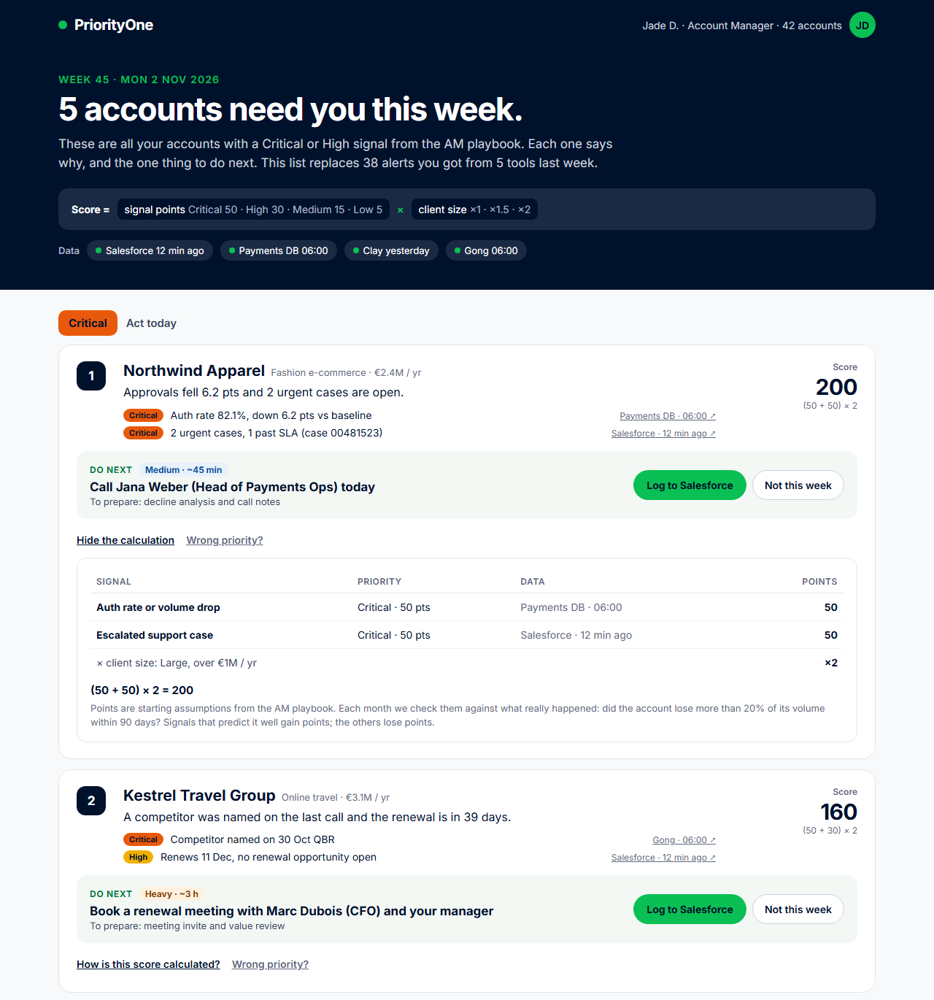
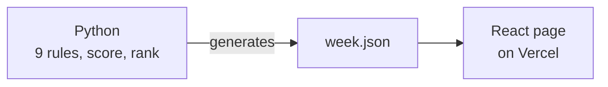
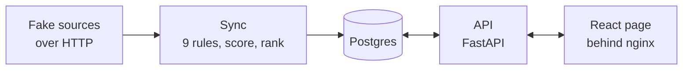

# PriorityOne

**One screen that tells an Account Manager which accounts to focus on this week, why, and what to do next.**

**[Open the live demo](https://priority-one-iota.vercel.app)** · no login, mock data only

[](https://priority-one-iota.vercel.app)

## Two folders

| Folder | What it is | Run it |
|---|---|---|
| [`demo/`](demo) | The page with fake data. Static files only: no server, no database, no login. This is the live link | Open the link |
| [`platform/`](platform) | The same product as a system you can deploy: Docker, Postgres, a login, and buttons that write to the database | `docker compose up` |

## The problem

Account Managers look after dozens of customers, and the warning signs are scattered across Salesforce, Gong, Clay and payment data. Checking every tool takes time, and the important signal gets lost in the noise.

PriorityOne reads those sources and replaces last week's 38 alerts from 5 tools with a short list: **5 accounts, each with a reason and one next step.**

## How an Account Manager uses it

1. **Open the page on Monday morning.** The accounts that need attention are already sorted.
2. **Read why.** Each card shows the signals behind it and where the data came from.
3. **Check the score.** "How is this score calculated?" shows the sum, so nothing is a black box. "Wrong priority?" lets the Account Manager disagree. The "How scoring works" page lists what each issue is worth.
4. **Act.** Each card gives one next step with a time estimate. In the demo, the buttons only show a message explaining what they would do. In the platform, they are saved in the database.

On the first visit, an 8-step tour points at each part of the page and says what each button does in production. "Take the tour" in the menu shows it again.

## How the score works

```text
Score = sum of signal points × client size
```

| Signal priority | Points | | Client size (yearly revenue) | Multiplier |
|---|---:|---|---|---:|
| Critical | 50 | | Small, under €100k | ×1 |
| High | 30 | | Medium, €100k to €1M | ×1.5 |
| Medium | 15 | | Large, over €1M | ×2 |
| Low | 5 | | | |

**Example:** Northwind Apparel has two Critical signals and is a Large client, so `(50 + 50) × 2 = 200`.

Accounts are ranked by **highest priority first, then by score**. That is why Halcyon (Critical, 83) sits above Pico (High, 90). Only Critical and High accounts reach the main list. The others appear under "Can wait".

## This week's result

| # | Account | Priority | Score | Why | What to do next |
|---:|---|---|---:|---|---|
| 1 | Northwind Apparel | Critical | **200** | Approvals fell 6.2 pts and 2 urgent cases are open | Call Jana Weber (Head of Payments Ops) today |
| 2 | Kestrel Travel Group | Critical | **160** | A competitor was named on the last call and the renewal is in 39 days | Book a renewal meeting with Marc Dubois (CFO) and your manager |
| 3 | Halcyon Hotels | Critical | **83** | A payout case is 4 days past SLA and nobody has spoken to them in 63 days | Call Siobhan Kelly (Finance Director) with a fix date from Support |
| 4 | Pico Subscriptions | High | **90** | Your champion left in October and the renewal is in 64 days | Send an intro email to Tom Hughes |
| 5 | Vantor Gaming | High | **60** | 75 days after go-live, volume is 38% below what they committed | Ramp review with Erik Lund (COO): what is not live yet? |

**Can wait:** Lumen Mobility (45), Bloom & Co Grocers (15), Orbit Ticketing (8). The other 34 of the 42 accounts are healthy and stay off the page.

## The 9 signals

| Signal | Priority | It fires when... | Source |
|---|---|---|---|
| Auth rate or volume drop | Critical | Last 7 days vs the previous 28: auth rate down 2 pts or more, or daily volume down 20% or more | Payments |
| Escalated support case | Critical | An open case is escalated, urgent or past its SLA | Salesforce |
| Competitor named on a call | Critical | A competitor was mentioned on a call in the last 14 days | Gong |
| Champion left | High | The champion left in the last 90 days | Clay, Salesforce |
| Renewal within 90 days | High | The contract ends within 90 days and no renewal opportunity is open | Salesforce |
| Ramp below commitment | High | 60+ days after go-live, the last 30 days are at least 25% below the commitment | Payments, Salesforce |
| Support cases piling up | Medium | 3 or more cases in 30 days | Salesforce |
| Low satisfaction score | Medium | The latest survey score is 6 or below | Salesforce |
| No call in 60+ days | Low | No call and no meeting for 60 days or more | Gong, Salesforce |

Rules, points, size bands and actions all live in one readable file: [`platform/config/playbook.json`](platform/config/playbook.json). The "How scoring works" page reads the same file, so it always shows the real points and thresholds.

## How it is built

**The demo** is one generated file and a page, so it cannot fail at runtime.



**The platform** runs the full flow in Docker. [Its README](platform/README.md) describes each service, route and table.



| Part | Tools |
|---|---|
| Scoring | Python 3.12 |
| Database | Postgres 17 |
| API | FastAPI: reads the week, saves actions, handles the login |
| Page | React and Vite, with driver.js for the first-visit tour |
| Packaging | Docker Compose |
| Hosting | Vercel for the demo. The platform runs on any server with Docker |
| Tests | pytest: 226 tests covering the rules, the score, the 8 demo accounts, the API and the sync, plus 10 against the running stack |

## Choices and trade-offs

| Choice | Why | What it costs |
|---|---|---|
| Two folders | The demo has nothing that can stop working, and the platform shows the real system | The page exists twice. The demo is a frozen copy |
| One copy of the scoring | Both folders show the same result, and a test checks it | The demo needs a regenerate step when the rules change |
| Rules instead of a model | Anyone can redo a score by hand and challenge it | Points and thresholds are human guesses until tested |
| Scores calculated by the sync | The page stays fast, and each run is kept for comparison | The page is only as fresh as the last sync |
| A failed sync keeps the last good week | The Account Manager never gets an empty page | The week can be out of date, and nothing flags it yet |
| One database login per service | A leaked API login cannot change a score, and the sync never sees the actions | Three logins to manage |
| The browser never talks to the database | Database access stays on the server | Every read goes through the API |
| One shared password | It protects the writes without an identity provider | Actions are saved as the account's owner, not as a person |

## Assumptions

- **Everything is fictional.** Companies, people and numbers are mock data, and no real system is connected.
- **Both versions are a snapshot.** The mock data ends on Sunday 1 November 2026, so the scoring stays on the following Monday morning. With real sources, it uses the real time.
- **The sources are shaped like exports from each tool.** The demo reads them as JSON files, and the platform fetches them over HTTP.
- **One Account Manager** owns all 42 accounts.
- **Points and thresholds are starting assumptions.** The 38 alerts baseline is invented too. Both would be checked with Account Managers and against what really happened to the accounts.

## Run it yourself

**The demo.** You need Node 22.

```bash
git clone https://github.com/jdasilvalima/priority-one.git
cd priority-one/demo
npm install
npm run dev
```

Then open <http://localhost:5173>.

**The platform.** You need Docker.

```bash
cd priority-one/platform
cp .env.example .env
docker compose up --build --wait
```

Then open <http://localhost:8080>. The password is `APP_PASSWORD` in your `.env`.

**The tests.** You need Python 3.12. Run these from the `platform` folder.

```bash
pip install -r requirements-dev.txt
python -m pytest
```

**After changing the data or the rules.** Run this from the `platform` folder to rebuild the demo's data.

```bash
python scripts/export_week.py
```

## Project layout

```text
demo/                    The static page and week.json
platform/
  app/                   Rules, score, sync, API, login
  config/playbook.json   The signals, points, size bands and actions
  data/                  Mock exports from Salesforce, Gong, Clay and payments
  db/                    Database migrations
  scripts/               Generate the mock data and the demo's week.json
  tests/                 The test suite
  web/                   The page, connected to the API
  docker-compose.yml     The whole stack
vercel.json              Publishes demo/ only
```

## Before production

[The platform's README](platform/README.md#before-real-customer-data) lists what real customer data would need: real sources, single sign-on, sending actions to Salesforce, alerts on out-of-date data, and backups.

Two product steps come with it:

- **Proof that it helps:** track whether accounts get handled sooner, then adjust the points every month.
- **Browser tests:** add automated tests for the page, which is only checked by hand today.
