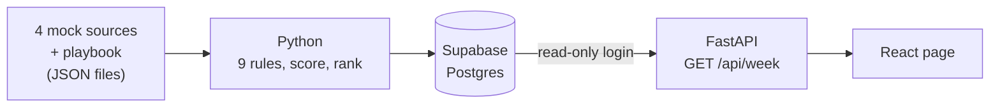

# PriorityOne

**One screen that tells an Account Manager which accounts to focus on this week, why, and what to do next.**

**[Open the live demo](https://priority-one-iota.vercel.app)** · no login, mock data only

[](https://priority-one-iota.vercel.app)

## The problem

Account Managers look after dozens of customers, and the warning signs are scattered across Salesforce, Gong, Clay and payment data. Checking every tool takes time, and the important signal gets lost in the noise.

PriorityOne reads those sources and replaces last week's 38 alerts from 5 tools with a short list: **5 accounts, each with a reason and one next step.**

## How an Account Manager uses it

1. **Open the page on Monday morning.** The accounts that need attention are already sorted.
2. **Read why.** Each card shows the signals behind it and where the data came from.
3. **Check the score.** "How is this score calculated?" shows the sum, so nothing is a black box. "Wrong priority?" lets the Account Manager disagree.
4. **Act.** Each card gives one next step with a time estimate. In this demo, the buttons only show a message explaining what they would do in production.

## How the score works

```text
Score = sum of signal points × client size
```

| Signal priority | Points | | Client size (yearly revenue) | Multiplier |
|---|---:|---|---|---:|
| Critical | 50 | | Small, under €100k | ×1 |
| High | 30 | | Medium, €100k to €1M | ×1.5 |
| Medium | 15 | | Large, over €1M | ×2 |
| Low | 5 | | | |

**Example:** Northwind Apparel has two Critical signals and is a Large client, so `(50 + 50) × 2 = 200`.

Accounts are ranked by **highest priority first, then by score**. That is why Halcyon (Critical, 83) sits above Pico (High, 90). Only Critical and High accounts reach the main list. The others appear under "Can wait".

## This week's result

| # | Account | Priority | Score | Why | What to do next |
|---:|---|---|---:|---|---|
| 1 | Northwind Apparel | Critical | **200** | Approvals fell 6.2 pts and 2 urgent cases are open | Call Jana Weber (Head of Payments Ops) today |
| 2 | Kestrel Travel Group | Critical | **160** | A competitor was named on the last call and the renewal is in 39 days | Book a renewal meeting with Marc Dubois (CFO) and your manager |
| 3 | Halcyon Hotels | Critical | **83** | A payout case is 4 days past SLA and nobody has spoken to them in 63 days | Call Siobhan Kelly (Finance Director) with a fix date from Support |
| 4 | Pico Subscriptions | High | **90** | Your champion left in October and the renewal is in 64 days | Send an intro email to Tom Hughes |
| 5 | Vantor Gaming | High | **60** | 75 days after go-live, volume is 38% below what they committed | Ramp review with Erik Lund (COO): what is not live yet? |

**Can wait:** Lumen Mobility (45), Bloom & Co Grocers (15), Orbit Ticketing (8). The other 34 of the 42 accounts are healthy and stay off the page.

## The 9 signals

| Signal | Priority | It fires when... | Source |
|---|---|---|---|
| Auth rate or volume drop | Critical | Last 7 days vs the previous 28: auth rate down 2 pts or more, or daily volume down 20% or more | Payments |
| Escalated support case | Critical | An open case is escalated, urgent or past its SLA | Salesforce |
| Competitor named on a call | Critical | A competitor was mentioned on a call in the last 14 days | Gong |
| Champion left | High | The main contact left in the last 90 days | Clay, Salesforce |
| Renewal within 90 days | High | The contract ends within 90 days and no renewal opportunity is open | Salesforce |
| Ramp below commitment | High | 60+ days after go-live, the last 30 days are at least 25% below the commitment | Payments, Salesforce |
| Support cases piling up | Medium | 3 or more cases in 30 days | Salesforce |
| Low satisfaction score | Medium | The latest survey score is 6 or below | Salesforce |
| No call in 60+ days | Low | No call and no meeting for 60 days or more | Gong, Salesforce |

Rules, points, size bands and actions all live in one readable file: [`config/playbook.json`](config/playbook.json).

## How it is built



| Part | Tools |
|---|---|
| Scoring | Python 3.12 |
| Database | Supabase (Postgres) |
| API | FastAPI on Vercel, one route: `GET /api/week` |
| Page | React and Vite on Vercel |
| Tests | pytest, 176 tests covering the rules, the score, the 8 demo accounts, the database rows and the API |

## Choices and trade-offs

| Choice | Why | What it costs |
|---|---|---|
| Rules instead of a model | Anyone can redo a score by hand and challenge it | Points and thresholds are human guesses until tested |
| Scores calculated before loading | The page stays fast and simple | The data is a snapshot, not live |
| No login and no write route | Nothing can be changed from the page, so a shared link is safe | The buttons are not connected yet |
| The browser never talks to the database | Database access stays on the server | Every read goes through the API |
| A read-only database login | A leaked login could not change anything | Reloading data needs a separate manual step |
| A daily call to the API | It keeps the free Supabase project from pausing | It depends on a free plan, so it is not for production |

## Assumptions

- **Everything is fictional.** Companies, people and numbers are mock data, and no real system is connected.
- **The demo is a snapshot.** The mock data ends on Sunday 1 November 2026, so the page stays on the following Monday morning. In production, it would use the real time.
- **The sources are JSON files** shaped like exports from each tool.
- **One Account Manager** owns all 42 accounts.
- **Points and thresholds are starting assumptions.** The 38 alerts baseline is invented too. Both would be checked with Account Managers and against what really happened to the accounts.

## Run it yourself

You need Python 3.12 and Node 22.

**The page.** It needs no database: on your machine it reads `web/public/week.json`.

```bash
git clone https://github.com/jdasilvalima/priority-one.git
cd priority-one/web
npm install
npm run dev
```

Then open <http://localhost:5173>.

**The tests.** Run these from the `priority-one` folder.

```bash
pip install -r requirements-dev.txt
python -m pytest
```

**After changing the data or the rules.** The first command rebuilds the page data and the second rebuilds `db/seed.sql`.

```bash
python scripts/export_week.py
python scripts/make_seed.py
```

<details>
<summary><strong>Connect your own database and deploy</strong></summary>

1. Create a Supabase project, then run `db/schema.sql` and `db/seed.sql` in its SQL editor.
2. Give the read-only login a password in the SQL editor: `alter role week_reader password '...';`. Letters and digits are safest, because symbols must be percent-encoded in the address.
3. Copy `.env.example` to `.env` and fill in the address. Use the transaction pooler (port 6543) with the user `week_reader.<project-ref>`.
4. Check the connection with `python scripts/check_db.py`. It compares the database with the page data and confirms that writing is refused.
5. Import the repository into Vercel, choose the **Other** application preset, and add `DATABASE_URL_READONLY`. `vercel.json` does the rest.

</details>

## Project layout

```text
api/week.py            The only API route
app/                   Rules, score, page data, database access
config/playbook.json   The signals, points, size bands and actions
data/                  Mock exports from Salesforce, Gong, Clay and payments
db/                    Database tables and demo data
scripts/               Generate data, build the seed, check the connection
tests/                 The test suite
web/                   The React page
```

## Before production

- **Real data:** replace the JSON files with scheduled syncs from each tool.
- **Access:** add single sign-on, so each Account Manager sees only their own accounts.
- **Actions:** connect the buttons, for example to create a Salesforce task.
- **Monitoring:** alert when a sync fails, and show on the page when a source is out of date.
- **Proof that it helps:** track whether accounts get handled sooner, then adjust the points every month.
- **Browser tests:** add automated tests for the page, which is only checked by hand today.
