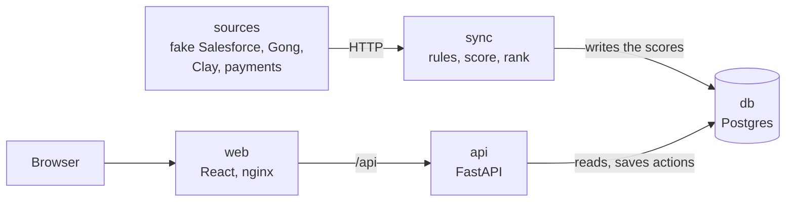

# PriorityOne platform

The same product as [`demo/`](../demo), built as a system you can deploy: Docker, Postgres, a login, and buttons that really write to the database. The sources stay fake, so it runs on any machine with no external account.

## Run it

You need Docker. Run these from the `platform` folder.

```bash
cp .env.example .env
docker compose up --build --wait
```

Then open <http://localhost:8080>. The password is `APP_PASSWORD` in your `.env`.

Try this: click **Log to Salesforce** on one account and **Not this week** on another, then reload the page. Both are still there, because they are in the database.

To stop it, run `docker compose down`. Add `-v` to erase the database too.

## What starts



| Service | Job | Database rights |
|---|---|---|
| `db` | Postgres, stored in a Docker volume | |
| `migrate` | Applies `db/*.sql` once, then stops | Owner |
| `sources` | Serves the 4 fake exports over HTTP | None |
| `sync` | Fetches the 4 sources, scores, stores a run | Writes scores, cannot see actions |
| `api` | Login, the week, saving actions | Reads scores, writes actions only |
| `web` | Serves the page and passes `/api` to `api` | None |
| `adminer` | Optional page to browse the database. Starts only when you ask | The login you type |

Only `web` and the optional `adminer` are published, and only on this machine. The `db`, `sources` and `sync` services sit on a private network with no way out.

**On first start**, the database is empty, so `sync` runs at once. It then runs every `SYNC_EVERY_MINUTES`.

**If a source is down**, the run is marked as failed and the page keeps showing the last good week. Try it: `docker compose stop sources`, and the page does not change.

## The API

| Route | Needs a session | What it does |
|---|---|---|
| `GET /api/health` | No | 200 once a first sync has finished |
| `POST /api/login` | No | Checks the password and sets the cookie. 5 attempts a minute |
| `POST /api/logout` | No | Clears the cookie |
| `GET /api/week` | Yes | The week, with what you already did |
| `POST /api/accounts/{id}/actions` | Yes | Saves `logged`, `snoozed` or `flagged` with a reason |
| `DELETE /api/accounts/{id}/snooze` | Yes | Puts the account back on the list |

## The tables

| Table | Holds |
|---|---|
| `users`, `accounts` | Who the accounts are. Kept up to date by each sync |
| `runs` | One row per sync: when, and whether it succeeded |
| `source_exports` | When each source was exported, per run |
| `scores`, `signals` | The result of each run, so past weeks stay comparable |
| `account_actions` | What the Account Manager did, one row per account, week and kind |

To change the database, add a numbered file in `db/`. `migrate` applies new files on the next start.

## Look inside the database

Start the database page:

```bash
docker compose --profile tools up -d --wait adminer
```

Then open <http://localhost:8081/?pgsql=db&username=postgres&db=priority>. The password is `DB_OWNER_PASSWORD` in your `.env`. This login can change every table, so use it to look, not to edit. To stop it with the rest, run `docker compose --profile tools down`: a plain `docker compose down` leaves it running.

In a terminal, `psql` shows the same data:

```bash
docker compose exec db psql -U postgres -d priority
```

## Test it

```bash
pip install -r requirements-dev.txt
python -m pytest
```

This runs everything that needs no Docker. With the stack running, this also tests the real database through the web server:

```bash
STACK_URL=http://localhost:8080 python -m pytest tests/test_stack.py
```

The stack test uses up the login limit, so wait a minute before signing in afterwards.

## Deploy it for real

Any server with Docker works.

1. Copy the repository to the server and create `.env` from `.env.example`.
2. Replace every value. `openssl rand -hex 24` gives a good one.
3. Set `COOKIE_SECURE=true`.
4. Put an HTTPS proxy, such as Caddy, in front of `127.0.0.1:8080`.
5. Run `docker compose up --build --wait`.

For a hosted Postgres, remove the `db` service and change `PGHOST`, then add `PGSSLMODE: require` to `api`, `sync` and `migrate`.

## Before real customer data

- **Real sources:** replace `sources` with extractors that return the same shapes. Real tools also need their own authentication and paging.
- **Clock:** leave `SCORING_CLOCK` empty, so the scoring uses the real time.
- **Access:** replace the shared password with single sign-on, so each Account Manager sees only their accounts. Behind a proxy, the login limit also needs the visitor's real address.
- **Actions:** send logged actions to Salesforce. Today they stop at the database.
- **Out-of-date data:** show on the page when a source is late, and alert when a sync fails.
- **Operations:** add backups, tests on every push, and a cleanup of old runs.
